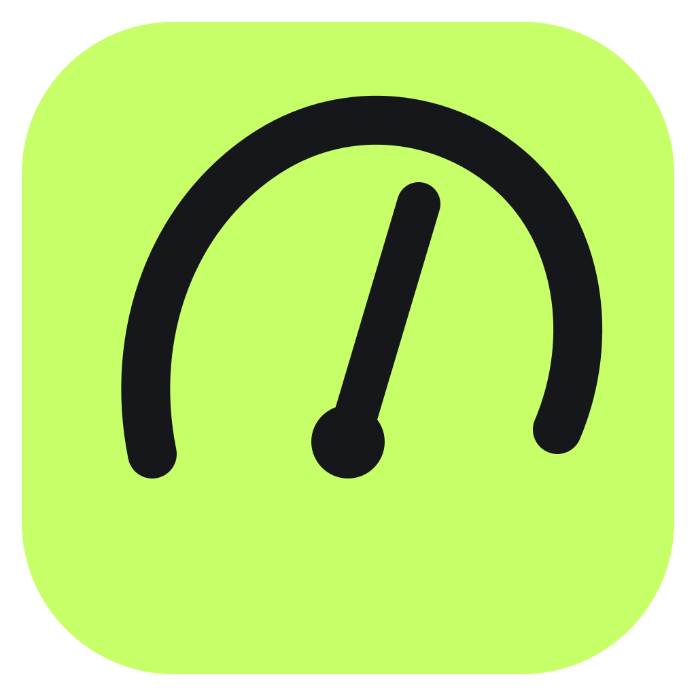

<p align="center">
  
</p>

<h1 align="center">Overcap</h1>

<p align="center">
  <strong>See the limit. Before you hit it.</strong>
</p>

<p align="center">
  Live quotas, reset times and spend across your coding tools.
</p>

<p align="center">
  <a href="https://github.com/AJ-Base44/overcap/actions/workflows/ci.yml"></a>
  <a href="https://github.com/AJ-Base44/overcap/releases/latest"></a>
  <a href="https://github.com/AJ-Base44/overcap/releases"></a>
  <a href="LICENSE"></a>
</p>

Overcap turns scattered quota data into one live capacity readout. See the tightest constraint
first, check the current pace, and know what resets next without breaking your flow.

## Download

| Platform | Available builds                           | Download                                                                     |
| -------- | ------------------------------------------ | ---------------------------------------------------------------------------- |
| Windows  | x64 and ARM64 installers                   | [Download for Windows](https://github.com/AJ-Base44/overcap/releases/latest) |
| macOS    | Universal DMG for Apple Silicon and Intel  | [Download for macOS](https://github.com/AJ-Base44/overcap/releases/latest)   |
| Linux    | x64 and ARM64 AppImage and Debian packages | [Download for Linux](https://github.com/AJ-Base44/overcap/releases/latest)   |

Open the latest release and choose the file for your platform:

- **Windows:** `_x64-setup.exe` or `_arm64-setup.exe`
- **macOS:** `_universal.dmg` (macOS 11 or later)
- **Linux:** `_amd64.AppImage` or `_amd64.deb` for x64; the ARM64/aarch64 equivalent for ARM64

Overcap 0.1.2 is a public beta. Its automatic updates are cryptographically signed, but its initial
Windows and macOS installers do not yet carry Microsoft or Apple developer signatures. Read the
[installation guide](docs/install.md) for the exact first-launch steps and security prompts.

## Features

- **Hero gauge.** The tightest live limit stays at the top, with a clear redline before the cap.
- **Pace projections.** See whether you will cap before reset and where monthly spend is heading.
- **Provider sparklines.** Scan the last seven days of token usage without opening another view.
- **Threshold alerts.** Set global or per-provider warnings at 80%, 95%, and 100%.
- **Share receipts.** Export usage and spend as a compact till-style PNG receipt.
- **Tray or desktop window.** Use the compact popup or keep Overcap visible in the taskbar or Dock,
  including on a second display.
- **Built-in restart and quit.** Restart or close Overcap from the app, Settings, or tray menu.
- **Used or left.** Show how much quota has gone or how much remains.
- **Custom layouts.** Reorder providers and metrics, hide rows, and add provider nicknames.
- **Local by default.** Overcap has no account, cloud backend, analytics, or usage telemetry.

## Supported providers

- **[Claude Code](docs/providers/claude.md)** - multiple accounts, session and weekly limits,
  model-specific usage, token history, and estimated spend
- **[Codex](docs/providers/codex.md)** - session and weekly limits, credits, token history, model
  breakdown, and estimated spend
- **[Cursor](docs/providers/cursor.md)** - total, Auto and API usage, credits, token history, and
  estimated spend
- **[Antigravity](docs/providers/antigravity.md)** - shared Gemini and Claude quota pools
- **[Copilot](docs/providers/copilot.md)** - premium requests, extra usage, chat and completion
  quotas, plus organization billing
- **[Devin](docs/providers/devin.md)** - daily and weekly limits, reset times, and extra usage balance
- **[Grok](docs/providers/grok.md)** - weekly allowance, extra usage status, token history, and
  estimated spend
- **[OpenCode](docs/providers/opencode.md)** - OpenCode Go session, weekly and monthly spend caps,
  plus local hosted usage history
- **[OpenRouter](docs/providers/openrouter.md)** - credit balance and daily, weekly and monthly spend
  (API key)
- **[Z.ai](docs/providers/zai.md)** - GLM Coding Plan session, weekly, and web-search quotas (API key)
- **[Kimi](docs/providers/kimi.md)** - Kimi Code session and weekly quotas (API key)
- **[MiniMax](docs/providers/minimax.md)** - Token Plan session and weekly quotas (API key)

Most providers reuse credentials already available on your computer. OpenRouter, Z.ai, Kimi, and
MiniMax require API keys added in Customize. Overcap stores them in your operating system's
credential store. Codex subscription limits require a ChatGPT login and are unavailable in
API-key-only sessions.

## Development

Requirements:

- Node.js 22 or later
- pnpm 11.11.0
- Stable Rust toolchain
- [Tauri 2 platform prerequisites](https://v2.tauri.app/start/prerequisites/)

Install dependencies and start the desktop app:

```sh
corepack pnpm install --frozen-lockfile
corepack pnpm tauri dev
```

Run the complete quality gate:

```sh
corepack pnpm verify
```

Build an installer for the current platform:

```sh
corepack pnpm build:installer             # Windows
corepack pnpm build:linux                 # Linux
corepack pnpm tauri build --bundles dmg   # macOS
```

## Contributing

Issues and pull requests are welcome. Read [CONTRIBUTING.md](CONTRIBUTING.md) first. Report security
problems privately through [SECURITY.md](SECURITY.md). For installation help and bug-report details,
see [SUPPORT.md](SUPPORT.md). Overcap's data handling is documented in [PRIVACY.md](PRIVACY.md).

## Credits

Overcap started life as [OpenQuota by deviffyy](https://github.com/deviffyy/OpenQuota). Full credit
to the original build. This fork rebrands, rethemes, and extends that foundation.

## License

[MIT](LICENSE)

<p align="center">
  <a href="https://overcap.dev">overcap.dev</a> · Open source under the MIT License
</p>
